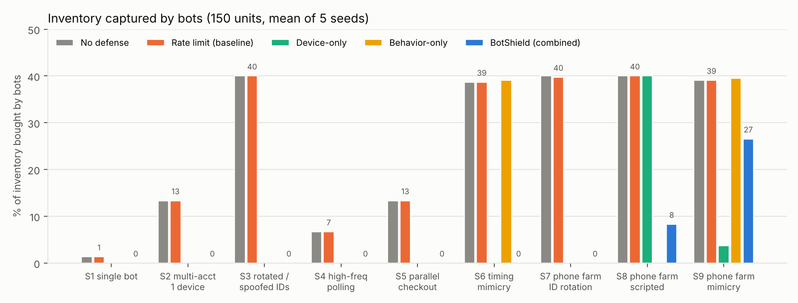
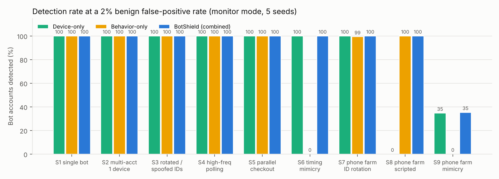

## 1. Problem, threat model, and changes since the proposal

BotShield protects a **mobile-app storefront** during a limited product drop. The goal is fair
access to inventory, not resale enforcement. The attacker is a scalper (OWASP OAT-005) who
controls many accounts, runs Android emulators or racks of real phones, rotates or spoofs device
IDs, uses residential/carrier proxies, can mimic human timing and inject touches, and can pay a
CAPTCHA-solving service. Payment fraud, server compromise and resale are out of scope.

The proposal feedback is addressed as follows:

- **Explicit risk score:** R = 1 − (1 − D)(1 − B), where D and B are documented weighted sums of
  [0, 1] components (README; `features.py`).
- **Rotation/spoofing:** device trust is anchored to a simulated hardware-backed attestation key
  (modeled on Play Integrity / App Attest), not to the claimed device ID.
- **Mobile/edge link:** the app SDK sends attestation tokens, touch counts and accelerometer liveness.
- **Benign bursts and ablations:** a realistic drop-time rush is always present, and device-only and
  behavior-only detectors are evaluated separately.

## 2. Current architecture (implemented and runnable)

- **Testbed (`sim.py`, `core.py`):** discrete-event simulation of the store backend. 100 units drop
  at t = 60 s plus a 50-unit restock at t = 360 s; limit 2 per account.
- **Benign users (400):** 250 drop-day shoppers (20% fast "enthusiasts"), 8% shared household
  phones, carrier NAT and campus Wi-Fi, 4% rooted and 10% brand-new phones, 150 background shoppers.
- **Attacks (`scenarios.py`):** S1 single script · S2 10 accounts on one emulator · S3 rotated *and
  spoofed* IDs · S4 0.1 s polling · S5 8 parallel checkouts · S6 emulator farm with human timing ·
  S7 phone farm rotating IDs by reinstalling · S8 real aged phones on a motion rig, scripted ·
  S9 real aged phones with human timing.
- **Defenses (`defenses.py`):** none · rate-limit baseline · device-only (D) · behavior-only (B) ·
  BotShield (R). Score-based defenses sit on top of the rate limiter and respond in steps:
  throttle → step-up challenge → block.
- **Calibration:** thresholds come from benign traffic only (seeds 101–105; evaluation uses 1–5).
  Throttle = 95th percentile, challenge = 98th, block = benign maximum + 0.05. Telemetry → SQLite.

## 3. Attack demonstrated: the baseline fails

Under the rate-limit baseline, bots captured **40% of the 150 units in S3, S7 and S8, and 39% in
S6 and S9**. The rate limiter does flag S1, S4, S5 and S7, but it does not stop their purchases,
because a purchase needs only a few requests.

{width=72%}

## 4. Preliminary results (5 seeds, 400 benign users, about 8,400 requests per run)

| Metric | Rate limit | Device-only | Behavior-only | **BotShield** |
|---|---|---|---|---|
| Bot share of inventory, S6 (emulators, human timing) | 38.7% | 0% | **39.1%** | **0%** |
| Bot share of inventory, S8 (real phones, scripted) | 40.0% | **40.0%** | 0% | **8.3%** |
| Bot share of inventory, S9 (real phones, human timing) | 39.1% | 3.7% | 39.5% | **26.5%** |
| Benign accounts over challenge threshold | 0% | 3.6% | 2.5% | **2.0%** |
| Benign shoppers blocked | 0% | 0.1% | 0% | **0%** |
| Scoring latency, mean / p95 (µs per request, in-process) | 1 / 2 | 43 / 75 | 43 / 74 | **49 / 86** |

**Why both views are needed.** Each single view has a blind spot the attacker can choose.
Human-like timing defeats behavior-only (S6). Clean, attested real phones defeat device-only (S8).
BotShield is the only detector that stops both. It does so while flagging the fewest benign
accounts (2.0%, against a 2% target). The device score takes few distinct values, so its calibrated
threshold generalizes worse (3.6% actual).

In S1–S7, BotShield flagged every bot **before the drop opened**. In S7, behavior-only needed a
median of about 60 s.

**Two bugs found by testing and fixed:**

1. A spoofer copying a customer's device ID poisoned the *victim's* device record. Attestation
   verdicts are now tracked per (device, account).
2. Our own throttle delay hid the bots' checkout speed. The speed feature now subtracts any delay
   the server imposed.

{width=72%}

**Honest failure: S9.** These bots run on real aged phones with valid attestation, one account
each, and human timing. They differ only in flat accelerometer data (the phones sit on a shelf).
At a matched 2% false-positive rate, device-only and BotShield both detect about **35%**.

Device-only looks better in enforcement (3.7% bot share), but only because it flags 3.6% of
benign users. In S8, BotShield challenges every bot, but its block threshold (0.47) sits above
their score (about 0.45), so CAPTCHA-solving lets some purchases through (8.3%). Behavior-only
blocks them outright.

## 5. Limitations and remaining work

**Limitations:** simulated testbed; HMAC-based attestation; challenge modeled as a pass
probability; hand-set weights; coarse device score.

**Before the final submission:**

1. S9 hardening: per-session sensor time-series features, and cross-account synchronization
   features (farms acting within the same second).
2. A logistic model trained on separate seeds, compared against the documented weights; revisit
   the block threshold (S8).
3. Sweeps over attacker budget (10–100 accounts), solver pass rate and inventory size; ROC curves.
4. An HTTP/Playwright version of the API for end-to-end latency and a comparison with FingerprintJS BotD.
5. An on-device SDK energy and bandwidth estimate (mobile/edge cost).

**Reproduce:** `python scripts/demo.py` · `python scripts/run_experiments.py` (about 3 minutes) ·
raw CSVs, thresholds, telemetry and figures are in `evidence/`.
